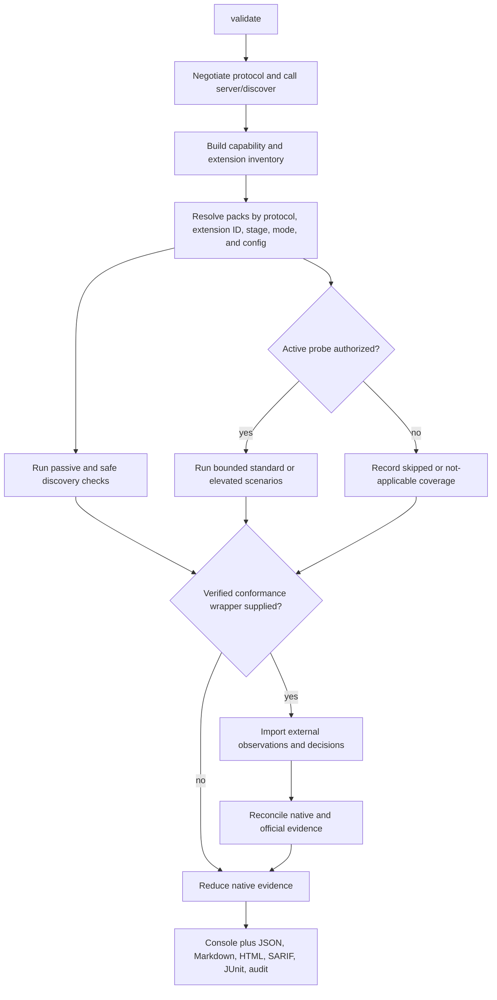
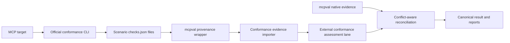

# MCP Extension And Official Conformance Integration Proposal

**Status:** Proposal only; no extension implementation is authorized by this document
**Reviewed:** 2026-11-04
**Base:** MCP Validator `main` after PR #101
**Decision horizon:** Re-evaluate official extension stages and conformance releases before each implementation phase

## Executive Decision

MCP Validator should not add Skills, Tasks, Apps, and official conformance as four equal features.

The recommended order is:

1. **Must add: official conformance companion and evidence import.** Run the official suite as a pinned external process, wrap its unversioned `checks.json` files in mcpval-owned provenance, and import the results into a separate assessment lane. Do not copy official scenarios into this repository.
2. **Must add: extension-aware applicability and provenance.** Add negotiated extension IDs, extension stage, specification revision, source digest, and policy behavior to the existing pack model. Extension failures must not silently alter core conformance.
3. **Should add first: MCP Apps server-security pack.** Apps is Stable, broadly implemented, and exposes a large server-controlled HTML/CSP/permission surface that the central conformance framework does not currently test.
4. **Should add as Preview: Skills security overlay.** Reuse official Skills conformance for wire behavior. Add bounded catalog-wide content, origin, manifest, and prompt-injection analysis because those are mcpval differentiators. Keep it non-blocking by default while Skills remains Beta.
5. **Import but do not duplicate yet: Tasks behavior.** The official suite already has extensive Tasks server scenarios. Tasks is Beta, its SDK is pre-release, and it is intended for Core. Import official evidence now; defer a native lifecycle pack until the extension stabilizes or a unique security certificate is defined.
6. **Do not prioritize now:** Server Cards, hosted UI execution, host sandbox conformance, skill activation/permission UX, or a new generic plugin runtime.

This order follows the MCP design principles of convergence, composability, interoperability, stability, demonstration, and standardization.

## Official Status Snapshot

| Surface | Official stage on 2026-11-04 | Adoption and evidence | Decision |
| --- | --- | --- | --- |
| MCP core | Current stable revision `2026-07-28` | Already embedded and exercised by mcpval | Maintain; do not create a replacement conformance definition |
| Official conformance | Official project, package `0.2.0-alpha.12` | Versioned requirement sets, wire-schema checks, server/client scenarios, 280 dependents | Integrate as a pinned companion, not an in-process dependency |
| MCP Apps | Stable revision `2026-01-26` | Claude, ChatGPT, VS Code, Goose, Postman, MCPJam; active SDK releases | Implement server-observable security pack first |
| MCP Tasks | Beta, destination Core | Official schema snapshot and extensive server scenarios; extension SDK `0.2.x` prerelease | Import official evidence; native pack remains Preview/deferred |
| Skills over MCP | Beta, destination not stated | Official server/client scenarios; TypeScript SDK released; several SDKs and hosts still partial/in progress | Add bounded security Preview after conformance import |
| OAuth client credentials | Stable revision keyed to `2026-07-28` | Official conformance scenarios and SDK support | Existing authentication roadmap owns this; close gaps there, not in a new generic extension project |
| Enterprise-managed authorization | Stable revision keyed to `2026-07-28` | Production IdP support and official conformance scenario | Existing authentication roadmap owns this |
| Server Cards | Official overview says Beta; repository README still says Experimental | No release and inconsistent maturity signals | Watch only until authoritative sources converge |

### Important maturity caveats

- Extensions are optional and disabled by default. Official conformance requirement sets classify extension scenarios as `not_scored`.
- The conformance package is still alpha. Its source currently labels `2026-07-28` as a draft constant even though the protocol revision is now released.
- A Final SEP is historical rationale. The current extension specification and lifecycle page are the implementation authorities.
- Skills moved into the Beta lifecycle directory recently and has no GitHub releases. Its accepted SEP does not make the extension Stable.
- Tasks publishes an immutable `2026-07-28` schema snapshot, but the extension lifecycle remains Beta and its npm releases are marked prerelease.

## Grounded Ecosystem Signal

These are time-sensitive adoption signals observed from official GitHub repositories and official implementation inventories on 2026-11-04. Re-check them at each phase gate; they are prioritization evidence, not protocol authority.

| Surface | External signal | What it demonstrates | Product implication |
| --- | --- | --- | --- |
| Official conformance | About 140 stars, 118 forks, 280 dependents, 57 contributors; package `0.2.0-alpha.12` | Real SDK/CI adoption, but the machine contract is still prerelease | Integrate for credibility and drift detection behind a pinned companion boundary |
| MCP Apps | About 3,000 stars, 428 forks, 50 contributors, 40 releases; current SDK `2.0.4` | Broad host/server use and active production maintenance | Highest-value first extension pack, especially for security visibility |
| Skills over MCP | About 762 stars, 67 forks, 18 contributors; no repository release | Strong interest and many server implementations, but host and SDK support is still uneven | Valuable AI-safety Preview, not a stable default gate |
| MCP Tasks | About 62 stars, 16 forks, 160 dependents, 11 contributors; current `0.2.3` prerelease | Useful async primitive with SDK consumers, but lower direct product adoption and continuing change | Import official tests; avoid duplicating a Beta-to-Core lifecycle suite |

### How the ecosystem uses these surfaces

- **Official conformance** is used by SDKs and implementations to test client/server wire behavior, frozen protocol-revision requirement sets, authentication flows, and extension scenarios. It produces check-level evidence, not security posture, operational readiness, or governance artifacts.
- **MCP Apps** is used to attach interactive HTML views to tools for charts, forms, media, dashboards, and multi-step workflows. The server controls UI metadata and HTML resources; the host controls sandboxing and user interaction.
- **Skills** is used to publish reusable workflow instructions and supporting files through MCP resources. Servers expose manifests and content; hosts verify, approve, namespace, cache, and load the instructions into model context.
- **Tasks** is used for long-running work, external jobs, approval waits, reconnectable operations, polling, and mid-flight input. The server creates durable task handles after the client declares support.

The product opportunity is not to implement these capabilities for users. MCP Validator should make their declared behavior, security boundary, evidence completeness, and interoperability visible and governable.

## Product Operating Model

### Keep the current command surface

Do not add separate `apps`, `skills`, or `tasks` top-level commands. The existing command ownership remains coherent:

| Command | Extension/conformance behavior |
| --- | --- |
| `mcpval health-check` | Bootstrap and transport health only. It may report advertised extension IDs but does not execute extension packs or import conformance runs. |
| `mcpval discover` | Shows negotiated extensions, official stage, recognized spec revision, available mcpval pack, and whether active validation requires opt-in. No scoring. |
| `mcpval validate` | Automatically resolves applicable stable/passive packs, imports explicitly supplied official evidence, executes governed probes, reduces decisions, and writes the unified artifact set. |
| `mcpval report` | Renders saved canonical evidence offline. It never contacts a target, downloads conformance tooling, or recomputes findings. |

This preserves one obvious workflow:

```bash
mcpval validate --server https://example.test/mcp --mode safe --output ./mcp-reports
```

The validator should enrich this workflow when the target advertises extensions, not require users to learn a second product.

### Add only two narrow CLI concepts

1. `--conformance-results <wrapper.json>` imports a previously generated, mcpval-wrapped official conformance run. Every scenario has a distinct identity and exact raw-payload digest. Raw `checks.json` is rejected because it lacks runner, requirement-set, target, run-state, and frozen-scenario provenance.
2. `--extension <identifier>` is repeatable and explicitly authorizes active Preview/Experimental extension probes. It does not force an undeclared extension to become applicable.

Equivalent configuration is required for repeatable CI. Do not add a separate extension policy mode; the existing advisory/balanced/strict policy remains the host gate, while lifecycle defaults cap what an extension is allowed to block.

The GitHub Action may later add:

- `official-conformance: false|true` to run a pinned companion before mcpval;
- `extension-probes: <comma-separated identifiers>` for explicit Preview/Experimental active probes;
- `conformance-version` only for an exact reviewed pin, never `latest`.

Because the official runner is alpha and HTTP-server-oriented, `official-conformance` remains opt-in initially. Enabling it must not install or execute mutable code outside the pinned Action revision.

### Automatic identification and execution



### Automatic behavior matrix

| Condition | Safe mode | Standard mode | Elevated mode |
| --- | --- | --- | --- |
| Extension not advertised | Record `notApplicable`; no extension request | Same | Same unless a controlled negative scenario explicitly owns the target |
| Unknown extension advertised | Inventory and schema-shape observation only | Same | Same; unknown code is never downloaded |
| Stable Apps advertised | Automatically validate negotiation, tool linkage, metadata, URI, CSP, and permission declarations | Also read bounded referenced UI resources and perform static HTML/CSP analysis | Reserved for future explicitly owned browser or cross-identity certificates; never automatic |
| Beta Skills advertised | Automatically run non-mutating catalog/manifest analysis as Preview and advisory | Content reads require `--extension io.modelcontextprotocol/skills`; remain Preview | Only explicitly configured controlled security scenarios |
| Beta Tasks advertised | Validate declaration and pinned response schemas without task creation | Import official evidence when supplied; no generic task creation | Native cross-identity/task-state security certificates require explicit extension opt-in and owned fixtures |
| Verified official conformance wrapper supplied | Import and display; core requirement-set failures can affect the external conformance verdict | Same | Same |
| Raw/unwrapped official checks supplied | Reject; require the bounded provenance wrapper | Same | Same |

Automatic means the target's negotiated extension inventory selects passive checks. It never means downloading extension code, running HTML, executing skill scripts, creating tasks, or escalating permissions without operator authority.

## Product And Repository Value

### Visibility

- One report shows core MCP verdicts, official conformance, extension readiness, security findings, and evidence gaps with distinct authorities.
- Extension declarations no longer look like support certificates when only negotiation was observed.
- Applied specification revisions and source digests make fast-moving Beta surfaces auditable.

### Usability

- Existing `validate` and `discover` workflows remain the entry points.
- Automatic passive detection means users do not need to know extension identifiers before the first run.
- Action hints explain the exact opt-in needed for deeper validation instead of silently skipping or attempting unsafe work.
- Offline `report` preserves reproducibility and allows governance teams to render the same evidence without target access.

### Credibility

- Official conformance evidence is visibly attributed instead of rebranded as mcpval-native evidence.
- mcpval stops competing with the official wire suite and concentrates on security, safety, coverage, policy, reports, attestations, and regression history.
- Evidence conflicts are surfaced, creating useful feedback for both projects and reducing silent specification drift.

### Repeated use

- Baseline comparison can identify extension regressions separately from core regressions.
- CI can retain a single signed artifact set while still linking to official scenario IDs.
- Stable Apps security findings and Preview Skills risks create actionable reasons to rerun on server or extension changes.
- A later badge/dashboard can project verified core and extension states without inventing a single misleading score.

## Unified Result And Report Design

The current rendering architecture is suitable. The HTML pipeline already separates the hero, release decision, metrics, domain summaries, decision trace, compatibility, evidence envelope, and detailed findings. Extend the report document and composers; do not build a second report application.

### Decision hierarchy

The first viewport remains core and policy focused:

1. Run status
2. Certificate eligibility and core conformance
3. Security assurance, operational readiness, and evidence limitation
4. Policy/release decision

Official conformance and extensions appear immediately after the neutral assurance surface, before client-profile compatibility and detailed evidence. They retain separate authority and applicability and are never averaged into another assessment.

### New HTML and Markdown sections

#### Official Conformance

Show:

- state: `Verified`, `Unverified`, `Not run`, `Incomplete`, or `Conflict`;
- pinned runner version/commit and requirement-set revision;
- required scenarios passed/failed;
- non-scored extension scenarios separately;
- failed official check IDs with source links;
- provenance and artifact digest;
- native/official conflict count.

#### Extension Readiness

One row per advertised extension:

| Field | Example |
| --- | --- |
| Extension | MCP Apps (`io.modelcontextprotocol/ui`) |
| Official stage | Stable |
| Spec revision | `2026-01-26` |
| Pack | `apps-server-security` revision and digest |
| Result | Compatible, review required, failed, not evaluated, or not applicable |
| Evidence | Covered/applicable checks and confidence |
| Active probes | Not required, not authorized, completed, or blocked |
| Highest finding | Concise rule/component summary |
| Next action | Exact mode/option or remediation |

Use the existing static, print-ready HTML visual language and expandable section pattern. No JavaScript dashboard, nested card hierarchy, or separate navigation application is required.

### Canonical JSON

Additive minor-version fields should conceptually follow this shape:

```json
{
    "assessments": {
        "officialConformance": {
            "verificationStatus": "verified",
            "runner": {},
            "requirementSets": [],
            "scenarioResults": [],
            "conflicts": []
        },
        "extensions": [
            {
                "extensionId": "io.modelcontextprotocol/ui",
                "stage": "stable",
                "specRevision": "2026-01-26",
                "pack": {},
                "verdict": "reviewRequired",
                "coverage": {},
                "findings": []
            }
        ]
    }
}
```

The canonical result stores the normalized projection. The full official wrapper remains a separately versioned subject artifact listed and hashed by the audit manifest.

### Other formats

| Output | Integration rule |
| --- | --- |
| Console | Add a compact `Official conformance` line and one `Extensions` summary; show at most the highest-signal next actions. |
| Markdown | Mirror HTML section order and terminology; retain full check/rule IDs for reviews. |
| SARIF | Emit only actionable verified failures/warnings with extension ID, stage, evidence origin, and official check ID properties. Do not emit success inventory as SARIF results. |
| JUnit | Use separate test suites for core mcpval, official conformance, and each extension pack. Skipped/unavailable states remain distinguishable from passes. |
| XML | Add explicit `OfficialConformance` and `Extensions` elements for parity with canonical JSON. |
| Profile summary | Keep client-profile interpretation separate. Add extension interpretation only when a dated profile source explicitly documents support. |
| Audit manifest | Hash the conformance wrapper, extension specs/schemas, applied pack manifests, and every rendered artifact. |
| Signed attestation | Sign the canonical result after imported and native evidence are finalized; include subject digests, not external raw payloads. |

### Baseline and regression behavior

- Compare core verdicts independently from extension verdicts.
- Compare an extension only when its ID, stage, spec revision, and pack revision are compatible.
- Compare official conformance only when runner identity and requirement-set digests are compatible.
- A newly advertised extension is a surface change requiring review, not automatically a regression.
- A removed extension is reported as a capability change; policy decides whether it blocks.
- Preview findings remain non-blocking by default even when they are new.
- Never blend extension findings into core conformance or unrelated assurance dimensions. Prefer typed claims, coverage, and confidence.

Lifecycle or revision changes make that extension's baseline comparison incompatible. Report the extension as changed and require baseline review; do not calculate a score delta across Beta-to-Stable, specification-revision, or pack-revision boundaries. After review, the operator records a new baseline. Core comparison remains valid when its own compatibility contract still matches.

### Resolved CLI and artifact edge states

| Situation | Required behavior |
| --- | --- |
| Explicit conformance wrapper is missing, unreadable, malformed, oversized, or fails provenance validation | Fail before target contact with a typed `CONFORMANCE_ARTIFACT_INVALID` stderr envelope and usage/configuration exit semantics. Never downgrade an explicitly requested import to a warning. |
| Wrapper is valid but records an incomplete/timed-out official run | Complete mcpval validation, record official conformance as incomplete/unavailable, and let the selected policy evaluate that evidence. |
| `--extension <id>` is requested but the target does not advertise it | Emit a concise warning, record the extension as `notApplicable`, and run no active probe. Requiring support is a separate explicit configuration policy, not implied by probe authorization. |
| Unknown extension is requested | Fail option validation with the supported identifier list; arbitrary extension code is never loaded. |
| Preview extension is newly advertised | Report a surface change and Preview findings; do not alter core conformance, security assurance, or certificate eligibility unless the selected policy explicitly requires that extension. |
| Extension stage/spec/pack differs from baseline | Mark extension comparison incompatible and require review; preserve independent core comparison. |

Dry-run output uses one compact extension block:

```text
Extensions:
    io.modelcontextprotocol/ui      stable   passive=yes  active=standard  pack=apps-server-security@<revision>
    io.modelcontextprotocol/skills  beta     passive=yes  active=not-authorized  pack=skills-preview@<revision>
Official conformance: import=<verified wrapper | none>; runner execution=external companion only
```

Preview and Experimental findings have their own extension claims, coverage, confidence, and policy projection. They do not affect core conformance. A selected policy may require an extension explicitly, but absence or failure never leaks into unrelated assessment dimensions.

The normal artifact set remains stable. Add one companion only when official evidence is supplied or generated:

- `mcp-validation-<timestamp>-official-conformance.json` contains the provenance wrapper and imported official records;
- the canonical `*-result.json` embeds only the normalized assessment projection and the companion digest;
- extension assessments remain inside canonical/rendered artifacts rather than creating one file per extension;
- the audit manifest lists and hashes the official companion, canonical projection, vendored extension source digests, and rendered outputs.

### Report implementation impact

The current HTML/report model needs additive changes only:

- extend the canonical assessment document;
- add official-conformance and extension summary models to the HTML report document;
- build those summaries in the existing document factory;
- render two sections in the existing composer;
- update Markdown/XML/SARIF/JUnit projections from the same canonical data;
- update schemas, snapshots, accessibility checks, hostile-text encoding tests, and byte-stability tests.

No renderer may contact the target or invoke the official conformance runner. The existing offline rendering contract remains intact.

## Product Decision Criteria

Every proposed pack must satisfy all of these conditions:

1. **Observable:** The validator can obtain evidence from the server or an explicitly supplied external artifact. Host-only behavior is reported as not observable, not inferred.
2. **Authoritative:** Every normative rule maps to a current specification requirement or an official conformance check ID.
3. **Non-duplicative:** Official conformance owns wire interoperability where a scenario already exists. mcpval adds security, evidence quality, policy, reports, and bounded operational analysis.
4. **Versioned:** The extension stage, revision, schema digest, rule revision, and conformance runner identity are captured in canonical evidence.
5. **Safe by default:** Discovery and metadata checks can run in safe mode. Content reads, tool calls, task creation, browser execution, and cross-account probes require stronger modes and explicit authority.
6. **Graceful:** Undeclared optional extensions are not failures. Declared-but-broken behavior is a finding. Unsupported or unobservable behavior remains explicit coverage debt.
7. **Calibrated:** No extension claim becomes default-blocking until its policy and corpus meet the V2 rule-quality gate.

## 1. Official Conformance Companion

### Value

- Establishes a recognizable external baseline instead of asking adopters to trust a second definition of MCP conformance.
- Prevents duplicate maintenance of core scenario behavior.
- Gives mcpval a defensible position: official conformance for wire behavior, mcpval for security, safety, operational evidence, policy, history, and attestations.
- Exposes differences between mcpval and the official suite as reviewable conflicts rather than hidden drift.

### Integration boundary

Do not fetch a mutable rule catalog at runtime and do not let external checks overwrite built-in findings.

Use this flow:



### Required provenance wrapper

Official per-scenario `checks.json` currently contains only check records. Before import, mcpval must create a wrapper containing:

- document type and schema version;
- conformance package version and package-integrity digest;
- official repository commit or immutable release tag;
- exact command and sanitized arguments;
- requirement-set revision and SHA-256 digest;
- negotiated protocol revision;
- target identity digest and transport;
- scenario name, extension ID when applicable, and result file digest;
- start/end time, exit code, timeout, and incomplete-run state;
- runner environment facts required for reproducibility.

An unwrapped `checks.json` is not accepted. The isolated companion must bind exact raw bytes to pinned runner, requirement-set, target, invocation, run-state, and frozen-scenario provenance before import.

### Status mapping

| Official check status | mcpval evidence treatment |
| --- | --- |
| `SUCCESS` | Covered observation; no automatic score bonus |
| `FAILURE` | Specification finding only when provenance and spec reference validate |
| `WARNING` | Review-required guideline/spec warning according to the referenced requirement |
| `SKIPPED` | Skipped or not-applicable coverage with the official reason retained |
| `INFO` | Observation only |
| Missing scenario output | Unavailable or error, never pass |

If native and official evidence disagree, emit a decision with category `EvidenceConflict`, gate `ReviewRequired`, and references to both observations. Do not add a stronger gate value merely to represent evidence origin. Neither source silently wins.

The importer accepts only the mcpval wrapper schema versions it explicitly supports. The embedded official check record has no schema version today, so the wrapper records the pinned runner version and validates the known check shape. Unknown statuses, missing required fields, unsupported wrapper majors, or runner/version mismatches fail closed. Additive content under `details` and `metadata` may be retained as opaque redacted JSON within configured size limits.

### Initial scope

- HTTP server mode only, because the official server runner accepts a URL.
- Pinned `@modelcontextprotocol/conformance` package and requirement-set digest.
- Core requirement sets first; extension scenarios remain a separate non-scoring group.
- CI companion first. Add local CLI orchestration only after the importer contract is stable.
- Never execute the official runner implicitly during `mcpval report` or offline replay.

### Exit gate

- Importer rejects malformed, path-escaping, oversized, duplicate-ID, unknown-status, and provenance-mismatched artifacts.
- Golden fixtures cover every official status and incomplete-run outcome.
- Differential tests prove imported official failures cannot become passes.
- A pinned official run against mcpval fixtures produces stable imported evidence.
- Canonical/report schemas add the lane additively under a new minor schema revision.

## 2. Extension-Aware Pack Foundation

The existing `IValidationScenarioPack`, applicability resolver, evidence ledger, coverage model, and deterministic reducers are sufficient. Do not add a generic plugin runtime.

Add only the missing typed data:

- `AdvertisedExtensionIds` on `ValidationApplicabilityContext`;
- `RequiredExtensionIds` on `ValidationApplicability`;
- extension descriptor metadata: identifier, lifecycle stage, specification revision, source URL, source digest, and default policy behavior;
- an external evidence origin for imported official checks;
- a separate extension verdict/coverage projection so optional features do not change core conformance by accident.

Use the existing `DecisionRecord` and `GateOutcome` model. Add a distinct external evidence origin/lane and conflict category; do not create a second severity or gate hierarchy.

Populate extension IDs from modern `server/discover`. Legacy pre-`2026-07-28` extension negotiation must be labeled non-core compatibility evidence because older published schemas did not define the `extensions` field.

### Pack lifecycle policy

| Official stage | mcpval stability | Default gate behavior |
| --- | --- | --- |
| Experimental | Experimental | Observation only |
| Beta | Preview | Non-blocking extension verdict; explicit opt-in required for active probes |
| Stable | Stable | May gate an explicitly selected extension policy; never required for core conformance |
| Promoted to Core | Stable core rule pack | Gate according to the dated core protocol revision |

The lifecycle defaults are enforced in code, not inferred by report renderers. Active Preview/Experimental probes also require an explicit per-extension configuration opt-in in addition to the existing execution-mode authority. Configuration may tighten a Stable extension policy but cannot make a Beta or Experimental pack part of core conformance.

### Exit gate

- Applicability tests cover declared, undeclared, malformed, and cross-version extension negotiation.
- Dry-run output names every selected extension pack, stage, revision, expected requests, and mutation risk.
- Pack revisions and source digests appear in audit manifests and canonical policy manifests.
- Undeclared extensions produce `notApplicable`, not `passed`.

## 3. MCP Apps Stable Server-Security Pack

### Why it is worth building

- It is the only candidate here at the Stable extension stage.
- It has broad production host support and active SDK releases.
- A server delivers executable HTML plus CSP, permissions, external origins, and tool linkage. This is a material security surface aligned with mcpval's purpose.
- The central official conformance repository currently has no dedicated Apps scenarios, leaving a useful gap for a security-focused validator.

### Safe-mode checks

- Validate `io.modelcontextprotocol/ui` extension settings and supported MIME types.
- Validate tool `_meta.ui.resourceUri` and `visibility` shapes.
- Detect deprecated flat `_meta["ui/resourceUri"]` usage without treating it as a core protocol failure.
- Validate `ui://` URI syntax and linkage consistency without requiring UI-only resources to appear in `resources/list`.
- Validate permission names and CSP origin syntax using structured URI parsing.
- Record requested camera, microphone, geolocation, clipboard, nested-frame, network, and static-resource access as explicit risk evidence.
- Check that UI-enabled tools still describe a meaningful non-UI purpose for graceful degradation.

### Standard-mode checks

- Read explicitly referenced UI resources through `resources/read`.
- Require `text/html;profile=mcp-app`, matching URI, and exactly one valid content representation (`text` or `blob`).
- Parse HTML with a maintained HTML parser; do not use regex as the primary parser.
- Compare static network/resource/frame/base references with declared CSP origins.
- Detect dangerous schemes, user-info, malformed origins, broad wildcard exposure, unexpected nested frames, and executable-object content.
- Verify bounded response size and record a content digest for report reproducibility.
- Validate text/structured tool-result fallback only when the operator supplies a reviewed, non-destructive test invocation.

Parser selection is a gated technical spike. Candidate libraries must pass malformed HTML, encoding, entity expansion, resource-bound, license, dependency-audit, and allocation benchmarks before adoption. The proposal does not preselect or require a new parser dependency.

### Explicit non-goals

- Do not claim that a host enforces iframe sandboxing, CSP headers, Permission Policy, postMessage source validation, approval prompts, tool visibility filtering, or teardown semantics.
- Do not launch arbitrary HTML in a browser during safe or standard mode.
- Do not add a 500 ms UI latency rule; the official specification defines no such server SLA.
- Do not tie Apps applicability to Claude, VS Code, or any other client profile. Applicability follows extension negotiation.

### Exit gate

- Vendor the immutable stable Apps schema/spec revision with source digest and license review.
- Fixture corpus includes compliant, missing fallback, malformed CSP, origin confusion, permission escalation, oversized HTML, invalid MIME, and deprecated metadata cases.
- Static checks are differential-tested against official ext-apps examples.
- No host-only requirement can produce a server failure.
- Mutation tests cover CSP/origin and visibility classification.
- At least two public or official example servers produce reviewed live certificates.

## 4. Skills Beta Security Preview

### Why it has value

Skills place server-authored instructions and supporting files into model context and can direct host-side tools. The official specification explicitly treats this as higher risk than remote tool invocation. This is highly aligned with mcpval's AI-safety and evidence model.

However, Skills remains Beta, has no repository releases, and several official SDK/host implementations are unreleased or partial. It must remain Preview.

### Reuse official conformance

Import the official server scenarios for:

- extension/resource capability declaration;
- `skills/list`, `skills/get`, pagination, caching, and errors;
- URI/name/frontmatter/resource manifest shape;
- SHA-256/size fields and limits;
- directory-read capability and behavior;
- read-back frontmatter consistency.

Import the official client scenarios only when validating a client implementation. Do not pretend a server run proves host digest verification, no-prefetch behavior, approval binding, or cache isolation.

### mcpval-specific overlay

Safe mode:

- bounded catalog analysis of manifests, collisions, origin identity, dynamic-resource declarations, reserved namespaces, and risk-bearing frontmatter;
- identify `allowed-tools`, scripts, hooks, external references, nested skills, and code-execution instructions as advisory risk evidence;
- treat digest matches as consistency evidence, never a trust anchor.

Standard mode:

- bounded, lazy reads of selected `SKILL.md` and supporting text resources;
- verify bytes, sizes, digests, frontmatter equality, relative-path containment, and manifest membership;
- run prompt-injection, secret-request, cross-origin read, code-execution, and permission-escalation analysis over verified content;
- never execute bundled scripts or honor skill-requested permissions.

Frontmatter must be parsed with a maintained YAML parser configured for bounded aliases, depth, scalar size, and total bytes. Do not write an ad hoc YAML parser. Parser selection follows the same license, audit, fuzz, and allocation gate as HTML parsing.

### Promotion gate

Do not make Skills a stable blocking pack until:

- the official extension reaches Stable or is promoted to Core;
- a dated immutable specification/schema revision is published;
- at least two official SDKs and two independent hosts have released complete support;
- official conformance outputs can be pinned with provenance;
- mcpval calibration includes benign, malicious, dynamic, stale-manifest, collision, nested-skill, and cross-origin cases.

## 5. Tasks Beta Evidence Strategy

### Why not implement a native lifecycle pack now

- The official conformance suite already covers capability negotiation, dispatch/envelope shape, lifecycle, wire fields, request state, MRTR input, headers, notifications, required-task errors, and MRTR composition.
- Tasks is Beta-to-Core and still publishes prerelease SDKs. Duplicating those checks now creates avoidable maintenance and drift.
- Correct active tests require task-capable fixture tools and create durable server-side state. Generic probing of arbitrary public servers is unsafe and often impossible without operator-provided inputs.

### What to add now

- Import official Tasks scenario evidence under the extension lane.
- Recognize the exact methods `tasks/get`, `tasks/update`, and `tasks/cancel`, plus `resultType: "task"`; do not invent `tasks/create`, `tasks/status`, or `tasks/result`.
- Surface declared Tasks support without assigning pass credit when behavior is untested.
- Add schema validation for the pinned official extension snapshot only when Tasks is negotiated.
- Preserve `Mcp-Name: <taskId>` routing-header evidence on Streamable HTTP.

Keep the legacy `2025-11-25` Tasks surface version-scoped. Its `tasks/list` and `tasks/result` methods remain valid historical-schema constants and must not be removed or applied to the modern extension. The modern `2026-07-28` extension adds `tasks/update` and does not use those legacy methods.

### Unique future security certificates

Consider native active checks only for controlled targets with explicit fixtures:

- task ID entropy and non-enumerability;
- per-request authorization binding across two controlled identities;
- cross-caller `tasks/get/update/cancel` rejection;
- TTL/resource-limit behavior under bounded workloads;
- input-request trust handling and duplicate-key behavior;
- cancellation and polling behavior within operator budgets.

These checks belong in elevated mode and must never run automatically against an arbitrary public server.

### Promotion gate

Implement a stable native Tasks pack only after Tasks reaches Stable/Core and the official runner publishes a stable package/result contract, or after a clearly non-duplicative security certificate is approved and calibrated.

## 6. Work Explicitly Deferred

| Work | Reason |
| --- | --- |
| Server Cards validation | Maturity signals conflict and no release exists; monitor official lifecycle |
| New auth-extension framework | Stable auth extensions already belong to the existing authentication validator and coverage roadmap |
| Host sandbox/browser conformance | Not observable from an MCP server; belongs to host/client testing |
| Automatic browser execution of Apps | High-risk and unnecessary for first server-security certificate |
| Skill installer, registry, or marketplace | Product scope is validation, not distribution or activation |
| Native duplication of official Tasks/Skills scenarios | Violates convergence and creates drift |
| Generic third-party plugin loading | Expands the trust boundary before built-in pack contracts are proven |
| Extension findings in core conformance | Optional extensions are not dated core requirements unless officially promoted |

## Delivery Plan

### Phase 0: Evidence contract

Deliverables:

- conformance provenance-wrapper schema;
- checks importer and hostile artifact corpus;
- external assessment lane and conflict outcome;
- pinned CI companion workflow against owned fixtures;
- schema/report documentation.

Exit: imported evidence is reproducible, non-recursive, redacted, and cannot change a verdict without a traceable decision.

### Phase 1: Extension-aware applicability

Deliverables:

- extension IDs in applicability context;
- lifecycle/revision/source metadata on applied packs;
- extension coverage and verdict projection;
- dry-run plan updates.

Exit: undeclared, malformed, Beta, Stable, and promoted-to-Core fixtures resolve deterministically.

### Phase 2: Apps stable pack

Deliverables:

- stable schema bundle;
- safe metadata/linkage rules;
- standard resource/CSP/HTML rules;
- adversarial fixtures, calibration cases, and live certificates.

Exit: Apps server-security evidence is independently useful and contains no host-conformance claims.

### Phase 3: Skills Preview

Deliverables:

- official scenario import;
- bounded catalog and verified-content security overlay;
- separate Preview policy and calibration corpus.

Exit: Preview reports are useful without affecting core release gates.

### Phase 4: Tasks decision checkpoint

Re-check official stage, SDK releases, conformance package stability, and real server adoption. Build only the unique controlled-target security certificates justified at that time.

## Cross-Cutting Quality Gates

Every phase must pass:

- architecture dependency tests;
- exact source/revision/digest checks for vendored specifications;
- JSON Schema validation for every new canonical artifact;
- positive, negative, unavailable, auth-required, throttled, and malformed fixtures;
- mutation tests for reducers and security-sensitive classifiers;
- parser/property fuzzing for imported JSON, HTML/CSP, manifests, URIs, and extension metadata;
- redaction and no-secret artifact scans;
- request, response-size, recursion, file-count, and total-byte budgets;
- deterministic replay and snapshot consistency across JSON, Markdown, HTML, SARIF, and JUnit;
- package/install smoke on Windows, Linux x64/ARM64, and macOS x64/ARM64;
- official conformance differential checks where overlap exists;
- live certificates against owned or explicitly authorized targets;
- documented false-positive and false-negative review;
- an explicit rollback path and no silent change to existing policy defaults.

All importer, Apps, Skills, and Tasks fixtures are committed, secret-free, versioned test assets. Tests never fetch mutable upstream fixtures or specifications at execution time. Updating an official snapshot requires an explicit source digest change and reviewed corpus diff.

Mutation scope includes both the external-status/import mapping and the existing verdict reducer paths that consume imported decisions. A passing importer-only mutation score cannot substitute for reducer coverage.

## Success Metrics

The work is successful when:

- adopters can see official conformance and mcpval security evidence in one report without confusing their authorities;
- no core-conformance changes merely because an optional extension is absent;
- declared extension behavior has explicit coverage rather than declaration-only pass credit;
- Apps reports identify actionable server-controlled CSP, permission, and UI-resource risks;
- Skills Preview finds verified-content and prompt-injection risks not covered by wire conformance;
- Tasks support tracks official evolution without maintaining a duplicate lifecycle suite;
- every conclusion names the extension revision, source digest, evidence origin, and execution mode.

## Official Sources

- [Current MCP specification](https://modelcontextprotocol.io/specification/latest)
- [MCP 2026-07-28 changelog](https://modelcontextprotocol.io/specification/2026-07-28/changelog)
- [MCP extensions overview and lifecycle](https://modelcontextprotocol.io/extensions/overview)
- [Extension client support matrix](https://modelcontextprotocol.io/extensions/client-matrix)
- [MCP design principles](https://modelcontextprotocol.io/community/design-principles)
- [SEP guidelines and conformance requirements](https://modelcontextprotocol.io/community/sep-guidelines)
- [Official MCP conformance framework](https://github.com/modelcontextprotocol/conformance)
- [Frozen 2026-07-28 conformance requirements](https://github.com/modelcontextprotocol/conformance/blob/main/requirements/2026-07-28.yaml)
- [Stable MCP Apps specification](https://github.com/modelcontextprotocol/ext-apps/blob/main/specification/2026-01-26/apps.mdx)
- [MCP Tasks extension](https://github.com/modelcontextprotocol/ext-tasks)
- [Tasks 2026-07-28 specification snapshot](https://github.com/modelcontextprotocol/ext-tasks/blob/main/specification/2026-07-28/tasks.md)
- [Skills Beta specification](https://github.com/modelcontextprotocol/ext-skills/blob/main/specification/beta/skills.mdx)
- [Skills implementation inventory](https://github.com/modelcontextprotocol/ext-skills/blob/649f7aee87d631ac4d1fdd3b12eef0c6264fdb3a/docs/implementations.md)
- [Stable MCP authorization extensions](https://github.com/modelcontextprotocol/ext-auth/blob/15ca394e00a66434520b9ade26294999295a43ae/README.md)
- [MCP feature lifecycle and deprecation policy](https://modelcontextprotocol.io/community/feature-lifecycle)
