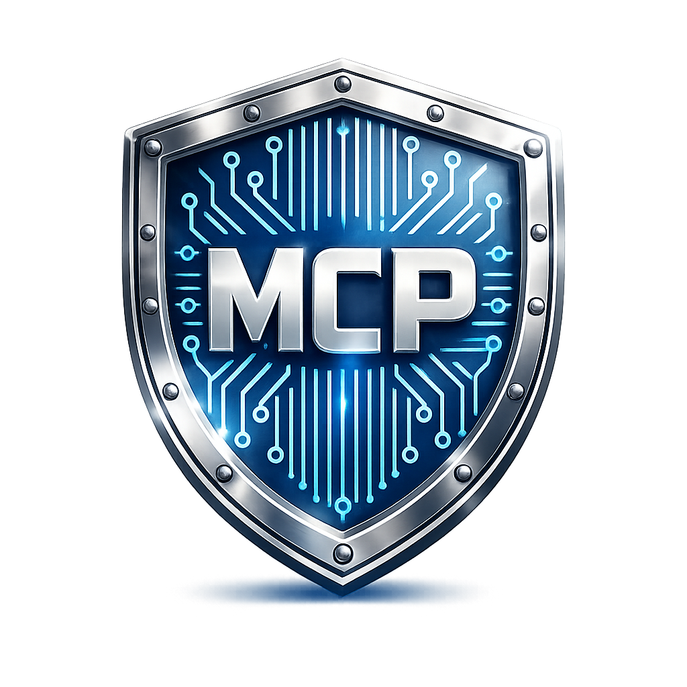

<p align="center">
  
</p>

# mcpval-localmcp

Local MCP server that wraps the [mcpval CLI](https://github.com/navalerakesh/mcp-validation-security) — validate MCP servers from any AI agent.

> **Breaking changes:** Upgrade this wrapper and the CLI together within the stable 3.x release family. Follow the [3.0 upgrade checklist](../docs/SchemaCompatibility.md#upgrading-to-30); support for historical result files does not imply compatibility with an older CLI.

## Quick Start (npx — no install needed)

```bash
npx -y mcpval-localmcp
```

This starts the MCP server via stdio. Any MCP-compatible AI agent can connect to it.

## Install

```bash
# Global install (optional — npx works without this)
npm install -g mcpval-localmcp
```

**Prerequisite:** Install a stable `mcpval` CLI from the same major release family as this wrapper (3.x for this codebase). Upgrade both packages together:

```bash
# Option 1: NuGet global tool (cross-platform, requires .NET 8)
dotnet tool install --global McpVal

# Option 2: Download standalone binary (no .NET needed)
# → https://github.com/navalerakesh/mcp-validation-security/releases
```

If the CLI is installed outside your default `PATH`, set `MCPVAL_CLI_PATH` to the full executable path in your MCP client configuration.

Before launching a target command, the wrapper checks the CLI's bounded `--version` response. Older or future major versions, prerelease versions and malformed responses produce a structured `CLI_VERSION_INCOMPATIBLE` error with exit `70`; no target command is launched. Matching stable minor/patch releases remain accepted. This release-family check is separate from reading historical artifact schemas; see [schema compatibility](../docs/SchemaCompatibility.md).

## Configure Your MCP Client

### VS Code / GitHub Copilot

Add to your `.vscode/mcp.json`:

```jsonc
{
  "servers": {
    "mcpval": {
      "command": "npx",
      "args": ["-y", "mcpval-localmcp"],
      "type": "stdio"
    }
  }
}
```

### Claude Desktop

Add to `claude_desktop_config.json`:

```json
{
  "mcpServers": {
    "mcpval": {
      "command": "npx",
      "args": ["-y", "mcpval-localmcp"]
    }
  }
}
```

### Cursor

Add to Cursor Settings → MCP Servers:

```json
{
  "mcpServers": {
    "mcpval": {
      "command": "npx",
      "args": ["-y", "mcpval-localmcp"]
    }
  }
}
```

### Windsurf

Add to `~/.windsurf/mcp.json`:

```json
{
  "mcpServers": {
    "mcpval": {
      "command": "npx",
      "args": ["-y", "mcpval-localmcp"]
    }
  }
}
```

### Any MCP Client

The server communicates via JSON-RPC over stdin/stdout. Point any MCP-compatible client at:

```bash
npx -y mcpval-localmcp
```

## Troubleshooting

### "mcpval CLI is not installed or not on PATH"

The MCP server needs the `mcpval` CLI accessible on PATH. If you installed via `dotnet tool install --global McpVal` but the MCP server can't find it, add `env` to your MCP config:

```jsonc
{
  "servers": {
    "mcpval": {
      "command": "npx",
      "args": ["-y", "mcpval-localmcp"],
      "type": "stdio",
      "env": {
        "PATH": "${env:HOME}/.dotnet/tools:${env:PATH}"
      }
    }
  }
}
```

Alternatively, download a standalone binary from [Releases](https://github.com/navalerakesh/mcp-validation-security/releases) and place it on your PATH.

If you prefer not to modify `PATH`, point directly at the CLI executable:

```jsonc
{
  "servers": {
    "mcpval": {
      "command": "npx",
      "args": ["-y", "mcpval-localmcp"],
      "type": "stdio",
      "env": {
        "MCPVAL_CLI_PATH": "/absolute/path/to/mcpval"
      }
    }
  }
}
```

On Windows, use the full path to `mcpval.exe`.

## Tools

| Tool | Description |
| --- | --- |
| `validate` | Evaluate typed claims, independent assurance assessments, and certificate eligibility for an MCP server |
| `health_check` | Quick connectivity check using version-appropriate discovery or initialization |
| `discover` | List tools, resources, and prompts exposed by a remote MCP server |

### Input Highlights

- `validate`: supports `server`, `access`, `token`, `interactive`, `mcpspec`, `protocolEra`, `policy`, `assurance`, `clientProfile`, bounded repeatable `extension` IDs, `reportDetail`, and `verbose`.
- `health_check`: supports `server`, `access`, `token`, `interactive`, and `protocolEra`.
- `discover`: supports `server`, `access`, `token`, `interactive`, `protocolEra`, and `format` (`json`, `yaml`, or `table`).

`protocolEra` accepts `auto`, `legacy`, or `modern`; prefer `auto` unless the target requires an explicit protocol generation.

`validate` defaults to `assurance: "comprehensive"`. Without operator-owned execution admission, conformance evidence, signed identity baseline and independently reserved validation ID, the CLI rejects the request before target contact. Use `assurance: "inventory"` explicitly for Safe discovery/static assessment. Comprehensive completeness qualification is still in progress; a successful inventory exit does not satisfy it.

Auto health checks can establish legacy initialization after unavailable modern discovery; explicit `modern` does not fall back. Health output includes the observed protocol separately from the selected plan, with control characters escaped. A successful inventory exit does not imply complete active security, tool-execution, identity, state or relay coverage; inspect the canonical claims and gaps.

## Security Behavior

- Authentication tokens are passed to the CLI through `MCPVAL_TOKEN`; temporary config contains only an environment `tokenRef`, never the token value or a command-line argument.
- Temporary config and artifact directories are removed after each tool execution.
- SDK cancellation propagates to the owned CLI process. CLI output is bounded; graceful wrapper shutdown waits for active CLI cleanup. POSIX runs require observed process-group exit. Windows uses the matching CLI's internal Job Object supervisor with creation-time ownership and explicit resume admission; incompatible CLIs fail with upgrade guidance rather than falling back to taskkill or signals. Cleanup requires a zero-active-process receipt and supervisor exit. These mechanisms are process hygiene, not a sandbox. Windows-native acceptance remains pending the dedicated CI gate.
- `validate` keeps structured result output when the underlying CLI exits non-zero but still emits validation artifacts, so agents can still inspect the real findings.
- `structuredContent.exitCode` preserves the CLI's stable V2 exit contract (`0`, `1`, `2`, `64`, `70`, `75`, or `124`) and includes explicit untrusted-content metadata for target-derived evidence.
- Remote endpoint validation is enabled by default. Local STDIO command execution is disabled because a command runs with the wrapper process's privileges.
- The wrapper uses the CLI's default safe mode. Safe mode performs discovery and static metadata/schema analysis and does not call target tools.
- Operators may admit standard comprehensive execution with `MCPVAL_COMPREHENSIVE_EXECUTION_MODE=standard`, `MCPVAL_OFFICIAL_CONFORMANCE_RESULTS`, `MCPVAL_IDENTITY_BASELINE`, and `MCPVAL_VALIDATION_ID` when starting this process. The file paths and independently reserved run ID are operator-owned; the CLI verifies target/protocol and signed control admission before active validation. Missing inputs do not enable admission. These inputs are not accepted from agent tool arguments, and `reportDetail` never grants execution authority. See the [CLI baseline contract](../Mcp.Benchmark.CLI/README.md#comprehensive-admission).
- The wrapper never accepts provider evidence paths from agent tool arguments. Operators may enable provider assurance for the process with `MCPVAL_PROVIDER_HARNESS`, `MCPVAL_PROVIDER_AUTHORIZATION_KEY`, `MCPVAL_OFFICIAL_CONFORMANCE_RESULTS`, and `MCPVAL_ATTESTATION_PRIVATE_KEY_PEM`; all four are required. Provider assurance then selects standard mode, where the CLI verifies signed authorization and the admitted plan before target contact. The wrapper fails closed when any trust input is absent.
- The MCP tool returns canonical JSON evidence, not generated HTML or Markdown bytes. `reportDetail` controls temporary CLI report generation only; use the CLI `report` command outside the wrapper when a durable human report is required.

`discover` follows the upstream CLI behavior and is currently intended for remote HTTP MCP endpoints.

To validate a reviewed local command, start the wrapper in a disposable, restricted environment with `MCPVAL_ENABLE_LOCAL_EXECUTION=true`. This opt-in changes the published MCP tool schema and server instructions for that process. Do not enable it on a workstation or shared runner for untrusted commands.

## Examples

Once configured, ask your AI agent:

- "Validate the MCP server at <https://my-server.com/mcp>"
- "Check if <https://api.example.com/mcp> is healthy"
- "What tools does this MCP server expose?"

## Local Integration Gate

The full repository validation script and Build & Test CI job build the CLI and wrapper, then run the SDK-to-wrapper-to-CLI integration test against the repository's controlled STDIO fixture. It checks canonical inventory output, actual target-side discovery/non-execution, numeric exits, protocol-era forwarding, request cancellation, graceful host shutdown and temporary-artifact cleanup with an isolated home and minimal environment. PID observations must confirm owned CLI/fixture termination before cleanup is accepted.

To run it separately from the repository root after building both projects:

```bash
MCPVAL_INTEGRATION_CLI="$PWD/Mcp.Benchmark.CLI/bin/Debug/net8.0/mcpval" npm --prefix mcpval-mcp run test:integration
```

Use the `.exe` apphost on Windows. The gate fails rather than skips when its CLI prerequisite is missing. `MCPVAL_INTEGRATION_SERVER` can select an installed package's server entry point for packed-package qualification. This local synthetic test is not certification of external servers or proof of cross-platform behavior.

## Links

- [mcpval CLI](https://github.com/navalerakesh/mcp-validation-security) — the core validation tool
- [NuGet Package](https://www.nuget.org/packages/McpVal) — install via dotnet
- [MCP Specification](https://modelcontextprotocol.io/specification)
- [Report Issues](https://github.com/navalerakesh/mcp-validation-security/issues)
